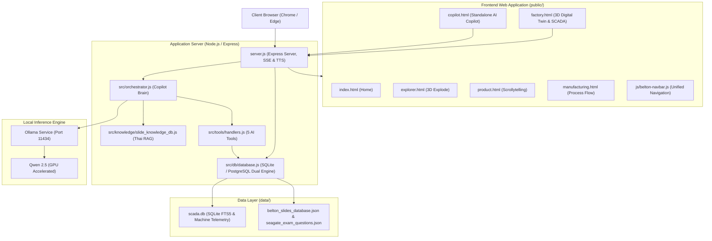

# BELTON Industrial 3D Digital Twin & AI SCADA Fleet

> **Enterprise-Grade Smart Manufacturing Platform**  
> เว็บแอปพลิเคชันจำลองโรงงานคลีนรูม 3 มิติเสมือนจริง (Digital Twin), ระบบมอนิเตอร์เครื่องจักร SCADA แบบเรียลไทม์ 50 เครื่อง, และวิศวกรผู้ช่วย AI Copilot (100% Local GPU) พร้อมระบบค้นหาฐานข้อมูลสไลด์ฝึกอบรมวิศวกรรมและข้อสอบมาตรฐาน

---

## จุดเด่นของระบบ (Key Capabilities)

1. **3D Cleanroom Digital Twin (`/factory`)**: จำลองสภาพแวดล้อมคลีนรูม Class 100 ของโรงงาน Belton นวนคร ด้วยโมเดล 3D ความละเอียดสูง (Three.js) พร้อมระบบเดินสำรวจแบบ First-Person, Bird-Eye View และระบบสั่งวาร์ปกล้องไปยังเครื่องจักรเป้าหมาย
2. **Real-Time Fleet SCADA (`/factory`)**: ระบบติดตามสถานะและ Telemetry ของเครื่องจักรหยอดกาวอัตโนมัติ (Asymtek Dynamic Dispenser) 50 เครื่อง ติดตามค่า Yield, Cpk, แรงดันลม CDA, อุณหภูมิ Pre-heat, การสึกหรอของหัวเข็ม และปริมาณกาวแบบเรียลไทม์
3. **Local AI Copilot & Voice Assistant (`/copilot`, `/factory`)**: วิศวกร AI ผู้ช่วยประจำโรงงาน รันบน Local GPU 100% ตอบคำถามวิเคราะห์เครื่องจักรผ่าน Function Calling (5 เครื่องมือ), ระบบเสียงพูดภาษาไทย (Neural TTS), และอ้างอิงสไลด์ฝึกอบรมวิศวกรรมพร้อมข้อสอบมาตรฐานแบบเรียลไทม์ (RAG)
4. **Interactive 3D Component Explorer (`/explorer`)**: ถอดประกอบและแยกชิ้นส่วน (Explode View) โมเดลฮาร์ดดิสก์ HDD Actuator Coil แบบอินเทอร์แอคทีฟ 360 องศา
5. **Product & Manufacturing Scrollytelling (`/product`, `/manufacturing`)**: นำเสนอสินค้า 4 หมวดหมู่ (APFA, ACA, FCOF, COIL) ด้วยอนิเมชัน 240 เฟรม และแผนผังโฟลว์กระบวนการผลิตทั้งโรงงาน

---

## สถาปัตยกรรมระบบ (System Architecture)



---

## โครงสร้างโปรเจกต์และหน้าที่ของแต่ละส่วน (Codebase Map)

```text
belton_live_preview/
├── ClickToRun.bat                # สคริปต์ 1-Click เปิดระบบอัตโนมัติบน Windows
├── README.md                     # เอกสารภาพรวมสถาปัตยกรรมและวิธีเริ่มต้นใช้งาน (ไฟล์นี้)
├── GEMINI.md                     # มาตรฐานการเขียนโค้ดและข้อกำหนดของโปรเจกต์
├── package.json                  # รายการ Dependencies และ NPM Scripts ของ Node.js
├── package-lock.json             # Lockfile ระบุเวอร์ชันแพ็กเกจที่แน่นอน
├── server.js                     # Express Server หลัก (Web Routes, SCADA APIs, AI Stream, Neural TTS)
├── .env.example                  # เทมเพลตตัวแปรสภาพแวดล้อมสำหรับตั้งค่าเครื่องใหม่
├── .gitignore                    # กฎการละเว้นไฟล์ชั่วคราวและไฟล์บิลด์ขนาดใหญ่
│
├── docs/                         # เอกสารส่งมอบงาน คู่มือระบบ และรายงานฉบับสมบูรณ์
│   ├── PROJECT_HANDOVER.md       # คู่มือส่งมอบงานสำหรับทีมวิศวกรและนักพัฒนาที่รับช่วงต่อ
│   ├── DEPLOYMENT_GUIDE.md       # คู่มือการติดตั้งและขึ้นระบบ Production Server
│   ├── PROJECT_REPORT_5_CHAPTERS.md              # รายงานโครงงาน 5 บท (Markdown)
│   ├── BELTON_PROJECT_REPORT_5_CHAPTERS.docx     # รายงานโครงงาน 5 บท (Word)
│   ├── BELTON_PROJECT_REPORT_COMPLETE_ACADEMIC.docx # รายงานฉบับสมบูรณ์ (Word)
│   ├── assets/                   # แผนภาพ Flowchart ประกอบเอกสาร
│   ├── degowning_slides/         # ภาพสไลด์ขั้นตอนการถอดชุดคลีนรูมประกอบเอกสาร
│   └── scripts/                  # สคริปต์สร้างเอกสารรายงานและแผนผังอัตโนมัติ
│
├── src/                          # โค้ดส่วน Backend Logic หลัก
│   ├── db/
│   │   └── database.js           # เชื่อมต่อ SQLite / PostgreSQL + ระบบ Auto-seed อัตโนมัติ
│   ├── knowledge/
│   │   ├── belton_knowledge.js   # องค์ความรู้วิศวกรรม Cleanroom, ESD, Contamination
│   │   └── slide_knowledge_db.js # ระบบค้นหาสไลด์และข้อสอบความเร็วสูง <1ms พร้อม Thai Tokenizer
│   ├── tools/
│   │   ├── schemas.js            # ข้อกำหนด Function Calling ของ AI Copilot (5 เครื่องมือ)
│   │   └── handlers.js           # โค้ดประมวลผลคำสั่งของแต่ละเครื่องมือ
│   └── orchestrator.js           # สมองกล AI Copilot ควบคุม RAG, Streaming SSE และเชื่อมต่อ Ollama
│
├── data/                         # แหล่งจัดเก็บข้อมูลหลัก (Master Data & SQLite)
│   ├── scada.db                  # ฐานข้อมูลหลัก (เครื่องจักร SCADA 50 เครื่อง + สไลด์ FTS5 + ข้อสอบ)
│   ├── belton_slides_database.json # ข้อมูลสไลด์ฝึกอบรมวิศวกรรม (JSON Master)
│   ├── seagate_exam_questions.json # ข้อมูลข้อสอบมาตรฐานกระบวนการผลิต (JSON Master)
│   └── documents/                # เอกสาร PDF ต้นฉบับ (เช่น Process Flow Chart PCBA)
│
├── ai/                           # โมเดล AI, Neural Network Training & Telemetry Simulation
│   ├── models/                   # โมเดลและค่าน้ำหนักที่เทรนแล้ว (.pt และ .json)
│   ├── data/                     # ข้อมูลสกัดสำหรับเทรน AI และสถานะจำลอง SCADA
│   ├── scripts/                  # สคริปต์จำลองและสตรีมข้อมูล SCADA แบบเรียลไทม์
│   ├── train_belton_copilot_ai.py# ไปป์ไลน์เทรนโมเดลผู้ช่วย AI Copilot
│   ├── train_dispensing_ai.py    # โค้ดเทรน Neural Network วิเคราะห์เครื่องหยอดกาว
│   ├── train_chatbot_nlp.py      # โค้ดเทรนโมเดลประมวลผลภาษาธรรมชาติ (NLP)
│   ├── build_qwen_knowledge_bank.py # สคริปต์สร้างคลังความรู้สำหรับโมเดล Qwen
│   ├── continual_learning_pipeline.py # ระบบเรียนรู้ต่อเนื่องของ AI
│   ├── generate_machine_telemetry_profiles.py # สร้างโปรไฟล์พารามิเตอร์เครื่องจักร 50 เครื่อง
│   └── dispensing_inference.py   # โมดูลทำนายผลคุณภาพการหยอดกาว
│
├── scripts/                      # สคริปต์จัดการฐานข้อมูลและเครื่องมือระบบ
│   ├── start_ollama.bat          # สคริปต์เปิดบริการ Ollama Local AI
│   ├── start_gpu_tunnel.bat      # สคริปต์เปิด Cloudflare Tunnel เชื่อมต่อ Local GPU กับ Cloud
│   ├── train_ai.bat              # สคริปต์รันการเทรนโมเดล AI
│   ├── extract_slides_to_db.py   # สกัดข้อมูลสไลด์ PDF เข้าสู่ฐานข้อมูล
│   ├── enrich_cleanroom_slides.js# อัปเดตข้อมูลขั้นตอนการสวม/ถอดชุดคลีนรูมเข้าฐานข้อมูล
│   ├── ingest_pcba_slides.py     # นำเข้าข้อมูลสไลด์กระบวนการผลิต PCBA
│   └── ingest_exam_questions.py  # นำเข้าชุดข้อสอบมาตรฐานเข้าสู่ฐานข้อมูล
│
├── raw_assets/                   # ไฟล์ต้นฉบับงานกราฟิก 3 มิติสำหรับแก้ไขต่อ
│   └── belton_factory_cleanroom_full.blend # ไฟล์ต้นฉบับ Blender โมเดลโรงงานคลีนรูม 3 มิติ
│
└── public/                       # Frontend Web Application (Client Side)
    ├── index.html                # หน้าหลัก / Landing Page / หุ่นยนต์ 3D แนะนำโรงงาน
    ├── explorer.html             # หน้า 3D HDD Component Explorer (แยกชิ้นส่วน Explode View)
    ├── product.html              # หน้านำเสนอสินค้า Scrollytelling 4 หมวด (APFA, ACA, FCOF, COIL)
    ├── manufacturing.html        # หน้านำเสนอโฟลว์กระบวนการผลิตทั้งโรงงาน
    ├── factory.html              # หน้า 3D Digital Twin คลีนรูม + แผงควบคุม SCADA 50 เครื่อง + AI Copilot
    ├── copilot.html              # หน้า AI Copilot แบบเต็มหน้าจอพร้อมระบบสั่งงานด้วยเสียง
    ├── styles.css, factory.css, product.css, manufacturing.css, copilot.css # สไตล์ชีตของแต่ละหน้า
    ├── css/
    │   └── belton-navbar.css     # สไตล์แถบเมนูนำทางส่วนกลาง
    ├── js/                       # สคริปต์ฝั่ง Frontend
    │   ├── belton-navbar.js      # คอมโพเนนต์แถบนำทางส่วนกลางและระบบควบคุมการเข้าถึง
    │   ├── main.js               # จัดการหน้าแรกและ 3D Scene
    │   ├── factory.js            # ควบคุมโรงงาน 3D Three.js, SCADA Cards, และแผงแชต AI
    │   ├── copilot.js            # ควบคุมหน้า AI Copilot, ระบบ Streaming SSE และเสียงพูด TTS
    │   ├── product.js            # ควบคุมอนิเมชัน Scrollytelling 240 เฟรม
    │   ├── manufacturing.js      # จัดการ Interactive Flow ในหน้ากระบวนการผลิต
    │   ├── robot3d.js            # หุ่นยนต์ 3D แนะนำโรงงาน
    │   ├── audio.js              # ระบบเสียง Sound Effects
    │   ├── scada_machines_data.js# ข้อมูลเริ่มต้นเครื่องจักรฝั่ง Client
    │   └── webllm_copilot_service.js # บริการ AI สำรองฝั่ง Client
    ├── models/                   # โมเดล 3D (.glb) และน้ำหนัก AI สำหรับใช้งานบนเว็บ
    ├── frames/, frames_b/, frames_c/, frames_d/ # ภาพอนิเมชันสินค้า 240 เฟรมต่อหมวด
    └── assets/                   # ไฟล์ภาพและสื่อประกอบหน้าเว็บ
```

---

## เริ่มต้นใช้งานด่วน (Quick Start)

### วิธีที่ 1: แบบ 1-Click บน Windows
ดับเบิลคลิกไฟล์ **`ClickToRun.bat`** ในโฟลเดอร์หลัก  
ระบบจะตรวจสอบ Node.js, ติดตั้ง Dependencies (หากเป็นการรันครั้งแรก), เปิดเว็บเบราว์เซอร์ และเริ่มเซิร์ฟเวอร์ให้อัตโนมัติทันที

### วิธีที่ 2: สั่งงานผ่าน Command Line
```bash
# 1. ติดตั้ง Dependencies
npm install

# 2. เริ่มการทำงานของเซิร์ฟเวอร์
npm start
```
เปิดใช้งานที่: **`http://localhost:8080`**  
- **รหัสผ่านเข้าสู่ระบบเริ่มต้น**: Username: `admin` | Password: `60632`

---

## รายละเอียดทางเทคนิค (Technical Specifications)

| ส่วนประกอบ | เทคโนโลยีที่เลือกใช้ | รายละเอียด |
|---|---|---|
| **Runtime** | Node.js (v18.0+) | Express Framework สำหรับ Web Server, SSE Streaming และ REST APIs |
| **3D Rendering** | Three.js (WebGL) | เรนเดอร์โมเดล 3D คลีนรูม, แสงเงา PBR, กล้อง Orbit และ First-Person |
| **Database** | SQLite (`better-sqlite3`) / PostgreSQL (`pg`) | รองรับ FTS5 Full-Text Search และระบบ Auto-seed ข้อมูลอัตโนมัติ |
| **Local AI** | Ollama (`qwen2.5`) | รันบน Local GPU, รองรับ Function Calling 5 เครื่องมือ และ RAG ค้นหาเอกสาร |
| **Voice TTS** | Microsoft Edge Neural TTS (`msedge-tts`) | สังเคราะห์เสียงพูดภาษาไทยพร้อมพจนานุกรมคำอ่านศัพท์วิศวกรรม |

---

## เอกสารสำหรับทีมรับมอบงาน (Handover & Deployment Documentation)

- **คู่มือส่งมอบงานสำหรับทีมพัฒนา (Handover Guide)**: อ่านได้ที่ [`docs/PROJECT_HANDOVER.md`](file:///c:/Users/BOAT/Videos/เลขา/belton_live_preview/docs/PROJECT_HANDOVER.md)
- **คู่มือการติดตั้งและขึ้นระบบเซิร์ฟเวอร์ (Deployment Guide)**: อ่านได้ที่ [`docs/DEPLOYMENT_GUIDE.md`](file:///c:/Users/BOAT/Videos/เลขา/belton_live_preview/docs/DEPLOYMENT_GUIDE.md)
- **รายงานโครงงานฉบับสมบูรณ์ 5 บท**: อ่านได้ที่ [`docs/PROJECT_REPORT_5_CHAPTERS.md`](file:///c:/Users/BOAT/Videos/เลขา/belton_live_preview/docs/PROJECT_REPORT_5_CHAPTERS.md)
