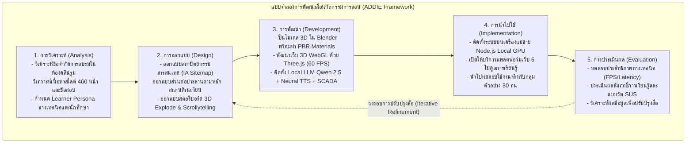
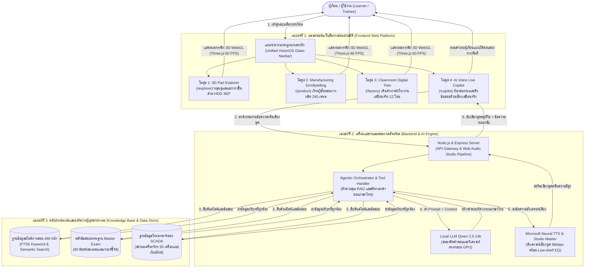

<div align="center">

# การออกแบบและพัฒนาสื่อนวัตกรรมปฏิสัมพันธ์เสมือนจริงสามมิติ<br>และปัญญาประดิษฐ์สนทนา เพื่อการถ่ายทอดองค์ความรู้<br>กระบวนการผลิตเชิงอุตสาหกรรม

<br><br><br>

### โดย
**นาย [ระบุชื่อ-นามสกุล ผู้จัดทำ]**<br>
รหัสนักศึกษา [ระบุรหัสนักศึกษา]

<br><br>

### อาจารย์ที่ปรึกษาโครงงาน
**[ระบุชื่อ-นามสกุล อาจารย์ที่ปรึกษา]**

<br><br><br><br>

**รายงานโครงงานนี้เป็นส่วนหนึ่งของการศึกษาตามหลักสูตรปริญญาบัณฑิต**<br>
สาขาวิชา [ระบุสาขาวิชา เช่น เทคโนโลยีมัลติมีเดีย / นวัตกรรมสื่อสารมวลชน / เทคโนโลยีดิจิทัล]<br>
คณะ [ระบุคณะ เช่น คณะเทคโนโลยีสารสนเทศ / คณะวิทยาการสื่อสาร / คณะเทคโนโลยีอุตสาหกรรม]<br>
[ระบุชื่อมหาวิทยาลัย / สถาบันการศึกษา]<br>
ปีการศึกษา 2567

</div>

<div style="page-break-after: always;"></div>

---

<div align="center">

## สารบัญ (Table of Contents)

</div>

### สารบัญเนื้อหา
- **บทที่ 1: บทนำ** ..................................................................................................................... 1
  - 1.1 ความเป็นมาและความสำคัญของปัญหา ....................................................................... 1
  - 1.2 วัตถุประสงค์ของโครงงาน ............................................................................................. 3
  - 1.3 สมมติฐานของการศึกษา .............................................................................................. 3
  - 1.4 ขอบเขตของโครงงาน .................................................................................................... 4
  - 1.5 กรอบแนวคิดในการวิจัยและสร้างสรรค์ .......................................................................... 5
  - 1.6 ประโยชน์ที่คาดว่าจะได้รับ ............................................................................................. 6
  - 1.7 นิยามศัพท์เฉพาะ ........................................................................................................ 6
- **บทที่ 2: เอกสาร วรรณกรรม และงานวิจัยที่เกี่ยวข้อง** .............................................................. 8
  - 2.1 แนวคิดและทฤษฎีเกี่ยวกับสื่อการเรียนการสอนและเทคโนโลยีการศึกษา ...................... 8
  - 2.2 ทฤษฎีภาระการรู้คิดและการเรียนรู้จากมัลติมีเดีย ........................................................... 9
  - 2.3 ทฤษฎีและหลักการออกแบบประสบการณ์และส่วนต่อประสานผู้ใช้ .............................. 11
  - 2.4 เทคโนโลยีคอมพิวเตอร์กราฟิกส์ 3 มิติบนเว็บและดิจิทัลทวิน ......................................... 12
  - 2.5 เทคโนโลยีปัญญาประดิษฐ์สนทนาและการประมวลผลเสียงพูด ...................................... 13
  - 2.6 กระบวนการผลิตชิ้นส่วนฮาร์ดดิสก์ไดรฟ์และข้อกำหนดห้องคลีนรูม ................................. 14
  - 2.7 งานวิจัยและงานสร้างสรรค์ที่เกี่ยวข้อง ......................................................................... 15
- **บทที่ 3: วิธีการดำเนินงานและการพัฒนาสื่อนวัตกรรม** .......................................................... 17
  - 3.1 ระเบียบวิธีพัฒนาสื่อตามแบบจำลอง ADDIE Model ................................................... 17
  - 3.2 การวิเคราะห์ความต้องการของผู้เรียนและระบบ ............................................................ 18
  - 3.3 การออกแบบสถาปัตยกรรมสารสนเทศและแผนผังเว็บไซต์ ........................................... 19
  - 3.4 แผนผังการทำงานของระบบและเส้นทางการเรียนรู้ของผู้เรียน ...................................... 20
  - 3.5 ขั้นตอนการสร้างสรรค์สื่อและพัฒนาระบบซอฟต์แวร์ .................................................... 22
  - 3.6 ประชากรและกลุ่มตัวอย่างในการประเมินผล ................................................................ 23
  - 3.7 เครื่องมือที่ใช้ในการทดสอบและประเมินผล ................................................................. 24
  - 3.8 วิธีการเก็บรวบรวมข้อมูลและการวิเคราะห์สถิติ ........................................................... 24
- **บทที่ 4: ผลการดำเนินงานและการวิเคราะห์ผล** ..................................................................... 25
  - 4.1 ผลลัพธ์การพัฒนาสื่อนวัตกรรมเสมือนจริงสามมิติ ........................................................ 25
  - 4.2 ผลการทดสอบประสิทธิภาพเชิงเทคนิคของระบบ ......................................................... 27
  - 4.3 ผลการประเมินด้านการถ่ายทอดองค์ความรู้และประสบการณ์ผู้ใช้ ................................ 28
  - 4.4 การอภิปรายผลการวิเคราะห์ข้อมูล ............................................................................. 30
- **บทที่ 5: สรุปผลการดำเนินงาน อภิปรายผล และข้อเสนอแนะ** ................................................. 31
  - 5.1 สรุปผลการดำเนินงานโครงงาน ................................................................................... 31
  - 5.2 อภิปรายผลเชิงวิชาการ ............................................................................................... 31
  - 5.3 ปัญหา อุปสรรค และแนวทางการแก้ไข ......................................................................... 32
  - 5.4 ข้อเสนอแนะในการนำผลงานไปประยุกต์ใช้งาน ........................................................... 33
  - 5.5 ข้อเสนอแนะในการศึกษาวิจัยและพัฒนาต่อยอด .......................................................... 33
- **บรรณานุกรม (References)** ............................................................................................... 35
- **ภาคผนวก (Appendices)** ................................................................................................... 37
  - ภาคผนวก ก: แบบประเมินประสิทธิภาพและความพึงพอใจการใช้งาน (SUS) ...................... 37
  - ภาคผนวก ข: ตัวอย่างสไลด์คู่มือการผลิต 460 หน้า และข้อสอบ Master Exam .................. 38
  - ภาคผนวก ค: ประวัติผู้จัดทำโครงงาน ................................................................................ 39

<div style="page-break-after: always;"></div>

---

<div align="center">

### สารบัญตาราง (List of Tables)

</div>

- ตารางที่ 2.1: การเปรียบเทียบภาระการรู้คิดระหว่างสื่อเอกสาร 2 มิติ กับสื่อเสมือนจริง 3 มิติ ........... 10
- ตารางที่ 2.2: สรุปงานวิจัยที่เกี่ยวข้องด้านสื่อนวัตกรรมเสมือนจริงและปัญญาประดิษฐ์ ....................... 16
- ตารางที่ 3.1: แผนการดำเนินงานตามแบบจำลอง ADDIE ตลอดระยะเวลาโครงงาน ............................ 18
- ตารางที่ 3.2: สรุปสเปกและรายละเอียดเครื่องมือซอฟต์แวร์และฮาร์ดแวร์ที่ใช้ในการพัฒนา ................. 23
- ตารางที่ 3.3: โครงสร้างประชากรและกลุ่มตัวอย่างในการประเมินประสิทธิภาพสื่อ (N = 30) ............... 24
- ตารางที่ 4.1: ผลการทดสอบประสิทธิภาพเชิงเทคนิคของแพลตฟอร์มสื่อ 3D และระบบ AI ................. 27
- ตารางที่ 4.2: การเปรียบเทียบเวลาในการทำความเข้าใจเนื้อหาและการค้นหาสเปกระหว่างสื่อเดิมกับสื่อใหม่ 28
- ตารางที่ 4.3: ผลการประเมินความพึงพอใจของผู้เรียนจำแนกตามรายด้าน (คะแนนเต็ม 5.00) ............. 29
- ตารางที่ 4.4: ผลการประเมินความสามารถในการใช้งานระบบตามแบบวัด System Usability Scale (SUS) 29

<div style="page-break-after: always;"></div>

---

<div align="center">

### สารบัญภาพ (List of Figures)

</div>

- ภาพที่ 1.1: กรอบแนวคิดการวิจัยและสร้างสรรค์สื่อนวัตกรรมปฏิสัมพันธ์เสมือนจริงสามมิติและ AI ..... 5
- ภาพที่ 2.1: แบบจำลองการประมวลผลข้อมูลมัลติมีเดียของ Mayer (Cognitive Theory of Multimedia) 10
- ภาพที่ 2.2: โครงสร้างชิ้นส่วน Actuator Coil Assembly ในฮาร์ดดิสก์ไดรฟ์ ........................................ 15
- ภาพที่ 3.1: ผังขั้นตอนการพัฒนาสื่อการสอนตามแบบจำลอง ADDIE Model .................................... 17
- ภาพที่ 3.2: ผังสถาปัตยกรรมระบบสื่อนวัตกรรมและเส้นทางการเรียนรู้ 4 เลเยอร์ ................................. 21
- ภาพที่ 3.3: แผนผังสถาปัตยกรรมข้อมูลเว็บไซต์ (Information Architecture Sitemap) ...................... 20
- ภาพที่ 4.1: หน้าจอสื่อการสอนโครงสร้างชิ้นส่วน 3D Explode Explorer และระบบ Hand Gesture .... 25
- ภาพที่ 4.2: หน้าจอสื่อการสอนขั้นตอนการผลิตแบบเลื่อนจอ Manufacturing Scrollytelling 240 เฟรม 26
- ภาพที่ 4.3: หน้าจอสื่อจำลองโรงงานคลีนรูมเสมือนจริง Cleanroom Digital Twin 12 โซน แบบผ่าตัดอาคาร 26
- ภาพที่ 4.4: หน้าจอระบบห้องเรียนรู้ปัญญาประดิษฐ์สนทนา Belton AI Copilot และโหมด Voice Live . 27
- ภาพที่ 4.5: กราฟเปรียบเทียบอัตราเฟรมเรต (FPS) ขณะเรนเดอร์ฉาก 3 มิติในแต่ละโหมดการแสดงผล 28
- ภาพที่ 4.6: แผนภูมิแสดงคะแนนความพึงพอใจของผู้เรียนจำแนกตามรายด้าน .................................... 30

<div style="page-break-after: always;"></div>

---

<div align="center">

### สารบัญคำย่อและสัญลักษณ์ (List of Abbreviations)

</div>

- **AI:** Artificial Intelligence (ปัญญาประดิษฐ์)
- **API:** Application Programming Interface (ส่วนต่อประสานโปรแกรมประยุกต์)
- **ASR:** Automatic Speech Recognition (การรู้จำเสียงพูดอัตโนมัติ)
- **CAD:** Computer-Aided Design (การออกแบบโดยใช้คอมพิวเตอร์ช่วย)
- **CLT:** Cognitive Load Theory (ทฤษฎีภาระการรู้คิด)
- **CUI:** Conversational User Interface (ส่วนต่อประสานผู้ใช้แบบสนทนา)
- **ESD:** Electrostatic Discharge (การคายประจุไฟฟ้าสถิต)
- **FPS:** Frames Per Second (อัตราเฟรมต่อวินาที)
- **FTS:** Full-Text Search (การค้นหาข้อความแบบเต็มรูป)
- **GPU:** Graphics Processing Unit (หน่วยประมวลผลกราฟิก)
- **HDD:** Hard Disk Drive (ฮาร์ดดิสก์ไดรฟ์)
- **IA:** Information Architecture (สถาปัตยกรรมสารสนเทศ)
- **ISD:** Instructional Systems Design (การออกแบบระบบการสอน)
- **LLM:** Large Language Model (โมเดลภาษาขนาดใหญ่)
- **PBR:** Physically Based Rendering (การเรนเดอร์ตามหลักฟิสิกส์กายภาพ)
- **RAG:** Retrieval-Augmented Generation (การสืบค้นข้อมูลเสริมการสร้างคำตอบ)
- **SCADA:** Supervisory Control and Data Acquisition (ระบบตรวจกำกับและรวบรวมข้อมูลเครื่องจักร)
- **SOP:** Standard Operating Procedure (คู่มือขั้นตอนการปฏิบัติงานมาตรฐาน)
- **SSE:** Server-Sent Events (การส่งเหตุการณ์จากเซิร์ฟเวอร์แบบทางเดียว)
- **SUS:** System Usability Scale (แบบวัดความสามารถในการใช้งานระบบ)
- **TTS:** Text-to-Speech (การสังเคราะห์เสียงพูดจากข้อความ)
- **UI:** User Interface (ส่วนต่อประสานผู้ใช้)
- **UX:** User Experience (ประสบการณ์ผู้ใช้)
- **VLE:** Virtual Learning Environment (สภาพแวดล้อมการเรียนรู้เสมือน)
- **WebGL:** Web Graphics Library (ไลบรารีกราฟิกสามมิติบนเว็บเบราว์เซอร์)

<div style="page-break-after: always;"></div>

---

<div align="center">

# บทที่ 1<br>บทนำ (Introduction)

</div>

## 1.1 ความเป็นมาและความสำคัญของปัญหา (Background and Rationale)

ในยุคเศรษฐกิจฐานความรู้ (Knowledge-based Economy) และการเปลี่ยนผ่านสู่อุตสาหกรรมอัจฉริยะ (Industry 4.0) อุตสาหกรรมการผลิตชิ้นส่วนอิเล็กทรอนิกส์ที่มีความแม่นยำสูงระดับไมโครเมตร (High-Precision Microelectronics) ถือเป็นกระดูกสันหลังสำคัญของห่วงโซ่อุปทานเทคโนโลยีสารสนเทศระดับโลก โดยเฉพาะอย่างยิ่งชิ้นส่วนขับเคลื่อนและอ่านบันทึกข้อมูลของฮาร์ดดิสก์ไดรฟ์ (Hard Disk Drive: HDD Actuator Coil Assembly) ซึ่งเป็นกลไกเชิงกลและแม่เหล็กไฟฟ้าที่มีความละเอียดอ่อนสูงสุดชิ้นหนึ่งในสายการผลิตอุตสาหกรรม แม้ว่าโรงงานสมัยใหม่จะมีการติดตั้งระบบอัตโนมัติ หุ่นยนต์หยอดกาวความเร็วสูง และระบบตรวจสอบด้วยกล้องอัจฉริยะ แต่ความสามารถในการรักษาคุณภาพและอัตราผลผลิตชิ้นงานสมบูรณ์ (Production Yield & Operational Excellence) ยังคงต้องพึ่งพา "สมรรถนะและความชำนาญการของทรัพยากรมนุษย์" เป็นศูนย์กลาง

อย่างไรก็ดี จากการศึกษาสภาพการณ์จริงของการฝึกอบรมและถ่ายทอดองค์ความรู้ (Vocational Training and Knowledge Transfer) ภายในโรงงานผลิตชิ้นส่วนอิเล็กทรอนิกส์ พบว่ากระบวนการเรียนรู้ดั้งเดิมกำลังเผชิญกับอุปสรรคและปัญหาเชิงโครงสร้าง 3 ประการหลัก ซึ่งส่งผลกระทบโดยตรงต่อประสิทธิภาพการเรียนรู้และต้นทุนการผลิตขององค์กร:

1. **ข้อจำกัดด้านสภาพแวดล้อมกายภาพของห้องปฏิบัติการคลีนรูม (Physical Cleanroom Constraints):**  
   กระบวนการประกอบชิ้นส่วน Actuator Coil ต้องดำเนินงานภายในห้องสะอาดควบคุมพิเศษ (Cleanroom Class 100 และ Class 1000) ซึ่งอนุญาตให้มีอนุภาคฝุ่นละอองขนาดเกิน 0.5 ไมครอนได้ไม่เกิน 100 ถึง 1,000 อนุภาคต่อหนึ่งลูกบาศก์ฟุต เพื่อป้องกันความเสียหายต่อหัวอ่านบันทึกข้อมูล ด้วยเหตุนี้ โรงงานจึงมีกฎบัตรความปลอดภัยและสุขอนามัยที่เข้มงวดสูงสุด การเข้าไปในพื้นที่ต้องผ่านขั้นตอนซับซ้อน ได้แก่ การสวมชุดสม็อคคลุมมิดชิดทั้งร่างกาย การเดินผ่านแผ่นกาวดักฝุ่น การเป่าลมในอุโมงค์ Air Shower และการสวมอุปกรณ์ป้องกันไฟฟ้าสถิต (Electrostatic Discharge: ESD) ส่งผลให้ "ไม่สามารถพาผู้เรียน นักศึกษาฝึกงาน หรือพนักงานใหม่เป็นกลุ่มใหญ่เข้าไปศึกษาดูงานหรือฝึกปฏิบัติจริงในสายการผลิตได้บ่อยครั้ง" เนื่องจากความเคลื่อนไหวของมนุษย์เป็นแหล่งกำเนิดฝุ่นละอองที่สำคัญที่สุด ซึ่งอาจก่อให้เกิดความเสี่ยงต่อการปนเปื้อนชิ้นงานราคาแพงและการสูญเสียชั่วโมงการผลิต

2. **ข้อจำกัดของสื่อการสอนแบบดั้งเดิมที่สร้างภาระการรู้คิดสูง (Ineffectiveness of 2D Static Instructional Media & High Cognitive Load):**  
   เอกสารที่ใช้ในการถ่ายทอดความรู้ในโรงงานยังคงพึ่งพาคู่มือขั้นตอนการปฏิบัติงานมาตรฐาน (Standard Operating Procedure: SOP) และชุดสไลด์บรรยายแบบสองมิติ (2D Presentation Slides) รวมกันมากกว่า 460 หน้า ซึ่งอัดแน่นไปด้วยข้อความทางเทคนิค ภาพถ่ายผังวงจรแบบแบนราบ และตารางสเปกตัวเลข การเรียนรู้ชิ้นส่วนกลไกสามมิติที่มีความละเอียดระดับไมครอน เช่น การพันขดลวด (Coil Winding), การหยอดกาวเฉพาะจุด (ACA Dispensing), การติดแผงวงจรความถี่สูง (FCOF), หรือการวางตำแหน่งแขนหัวอ่าน (APFA) ผ่านภาพ 2 มิติ บังคับให้ผู้เรียนต้องใช้กระบวนการทางปัญญาอย่างหนักในการสร้างมโนทัศน์เชิงพื้นที่สามมิติขึ้นในสมองเอง สภาพเช่นนี้ก่อให้เกิดภาระการรู้คิดส่วนเกิน (Extraneous Cognitive Load) ตามทฤษฎี Cognitive Load Theory ส่งผลให้ผู้เรียนเกิดความเหนื่อยล้า ไม่เห็นมิติด้านลึก ไม่เข้าใจกลไกการประกอบชิ้นส่วน และจดจำขั้นตอนที่ถูกต้องได้ยาก

3. **ข้อจำกัดของการสื่อสารทางเดียวและการขาดการประเมินผลโต้ตอบ (Passive One-way Learning & Delayed Feedback):**  
   การฝึกอบรมผ่านการฟังบรรยายหรือการอ่านเอกสารเป็นการสื่อสารทางเดียว เมื่อผู้เรียนเกิดข้อสงสัยเกี่ยวกับลักษณะข้อบกพร่องของชิ้นงาน (Defects เช่น รอยต่อกาวขาดหาย Bond Line Breakage, เส้นลวดหัก Wire Damage, หรือฟองอากาศในเนื้อกาว Void in Adhesive) ผู้เรียนไม่สามารถตรวจสอบหรือซักถามได้ทันที ยิ่งไปกว่านั้น วิศวกรผู้เชี่ยวชาญระดับสูงมีภารกิจหลักในการควบคุมผลผลิต ทำให้ไม่สามารถประกบดูแลหรือตอบข้อสงสัยของผู้เรียนได้ตลอดเวลา ขาดระบบพี่เลี้ยงเสมือน (Virtual Mentorship) ที่คอยทดสอบความรู้และให้คำแนะนำแบบเฉพาะบุคคลได้ตลอด 24 ชั่วโมง

ด้วยสภาพปัญหาข้างต้น ผู้วิจัยจึงได้ริเริ่มสร้างสรรค์ **"สื่อนวัตกรรมปฏิสัมพันธ์เสมือนจริงสามมิติและปัญญาประดิษฐ์สนทนา เพื่อการถ่ายทอดองค์ความรู้กระบวนการผลิตเชิงอุตสาหกรรม"** โดยพัฒนาขึ้นในรูปแบบแพลตฟอร์มเว็บแอปพลิเคชันเพื่อการเรียนรู้ (Web-based 3D Learning Platform) ที่ทำงานบนเว็บเบราว์เซอร์มาตรฐาน แพลตฟอร์มนี้ทำหน้าที่เป็น **"ห้องปฏิบัติการคลีนรูมเสมือนจริง (Virtual Cleanroom Laboratory)"** ที่จำลองโรงงานคลีนรูมขนาด 12 โซน เครื่องจักร 50 เครื่อง และชิ้นส่วน Actuator Coil Assembly 3 มิติที่สามารถหมุนดู 360 องศาและแยกร่างชิ้นส่วนได้ ควบคู่กับการพัฒนาระบบปัญญาประดิษฐ์สนทนาภาษาไทย (Conversational AI Teaching Assistant) ที่มีกล่องเสียงสังเคราะห์เสมือนมนุษย์ (Voice Live) คอยทำหน้าที่เป็นผู้ช่วยสอนเสมือนตอบคำถามและติวข้อสอบมาตรฐาน เพื่อเปลี่ยนผ่านจากการเรียนรู้แบบรับสารทางเดียวสู่การเรียนรู้เชิงรุก (Active Learning) ที่ลดภาระการรู้คิด ขจัดอุปสรรคด้านพื้นที่ และเสริมสร้างทักษะทางวิศวกรรมได้อย่างยั่งยืน

---

## 1.2 วัตถุประสงค์ของโครงงาน (Project Objectives)

1. เพื่อศึกษา วิเคราะห์ และออกแบบ **สื่อนวัตกรรมปฏิสัมพันธ์เสมือนจริงสามมิติ (Interactive 3D Virtual Instructional Media)** สำหรับการถ่ายทอดองค์ความรู้กระบวนการผลิตชิ้นส่วนอิเล็กทรอนิกส์ในห้องปฏิบัติการคลีนรูม
2. เพื่อพัฒนา **แพลตฟอร์มเว็บแอปพลิเคชันเพื่อการเรียนรู้เสมือนจริงสามมิติ (Web-based 3D Interactive Learning Platform)** ที่ผสานการจำลองสภาพแวดล้อมโรงงานคลีนรูม (Digital Twin 12 โซน), การแสดงโครงสร้างชิ้นส่วนแบบแยกร่าง 360 องศา (3D Explode Explorer), และการนำเสนอกระบวนการผลิตแบบเล่าเรื่องเชิงภาพ (Process Scrollytelling 240 เฟรม)
3. เพื่อพัฒนา **ระบบปัญญาประดิษฐ์สนทนาและสังเคราะห์เสียงผู้ช่วยสอนอัจฉริยะ (Conversational AI Teaching Assistant & Voice Live)** ที่สามารถตอบข้อซักถาม ติวข้อสอบมาตรฐานอุตสาหกรรม เชื่อมโยงข้อมูลสไลด์การสอน 460 หน้า และโต้ตอบด้วยเสียงพูดภาษาไทยเสมือนมนุษย์ผ่านเทคโนโลยี On-premise Local Deep Learning
4. เพื่อประเมิน **ประสิทธิภาพของสื่อนวัตกรรม** ทั้งในด้านประสิทธิภาพเชิงเทคนิคของการแสดงผลบนเว็บเบราว์เซอร์ และด้านผลสัมฤทธิ์ความพึงพอใจในการถ่ายทอดองค์ความรู้และการลดภาระการรู้คิดของผู้เรียน

---

## 1.3 สมมติฐานของการศึกษา (Research Hypotheses)

1. การเรียนรู้ผ่านสื่อนวัตกรรมปฏิสัมพันธ์เสมือนจริงสามมิติช่วยลดระยะเวลาในการทำความเข้าใจโครงสร้างและขั้นตอนการผลิตลงได้อย่างน้อย 2 เท่า เมื่อเปรียบเทียบกับการเรียนรู้ผ่านเอกสารสไลด์สองมิติดั้งเดิม
2. การผสานระบบปัญญาประดิษฐ์สนทนาและสังเคราะห์เสียงพูดภาษาไทยช่วยให้ผู้เรียนสามารถเข้าถึงข้อมูลข้อกำหนดมาตรฐานการผลิตได้รวดเร็วขึ้นและมีความพึงพอใจต่อการเรียนรู้อยู่ในระดับ "ดีมาก" ขึ้นไปตามแบบวัด System Usability Scale (SUS)
3. แพลตฟอร์มเว็บแอปพลิเคชันสามมิติสามารถแสดงผลได้อย่างมีเสถียรภาพที่อัตราเฟรมเรตไม่ต่ำกว่า 50 เฟรมต่อวินาที (FPS) บนเว็บเบราว์เซอร์มาตรฐาน

---

## 1.4 ขอบเขตของโครงงาน (Project Scope)

### 1.4.1 ขอบเขตด้านเนื้อหาและการเรียนรู้ (Content & Instructional Scope)
- องค์ความรู้กระบวนการผลิตชิ้นส่วนฮาร์ดดิสก์ไดรฟ์ (HDD Actuator Coil Assembly) ครอบคลุม 5 หมวดเทคนิคหลัก:
  1. กระบวนการพันขดลวด (Coil Winding Process: 14 ขั้นตอน)
  2. กระบวนการหยอดกาวประกอบชิ้นส่วน (ACA Dispensing Process: 21 ขั้นตอน)
  3. กระบวนการยึดติดแผงวงจรความถี่สูง (FCOF Attachment: 14 ขั้นตอน)
  4. กระบวนการประกอบแขนปรับตำแหน่งหัวอ่าน (APFA Process: 17 ขั้นตอน)
  5. การวิเคราะห์ข้อบกพร่องและมาตรฐานการซ่อมบำรุง (PCBA & Defect Troubleshooting: 30 ขั้นตอน)
- คลังสารสนเทศเอกสารข้อกำหนดการผลิต (SOP) และสไลด์การฝึกอบรมรวม 460 หน้า
- คลังข้อสอบวัดผลมาตรฐานอุตสาหกรรม (Master Exam) จำนวน 80 ข้อ พร้อมเฉลยและเกณฑ์ชี้วัด
- ฐานข้อมูลโทรมาตรจำลองเครื่องจักรหยอดกาวอัตโนมัติ (Asymtek Dispenser Fleet) จำนวน 50 เครื่อง ในระบบ SCADA

### 1.4.2 ขอบเขตด้านกลุ่มประชากรและกลุ่มเป้าหมาย (Target Population Scope)
- กลุ่มเป้าหมายหลัก: ช่างเทคนิคสายการผลิต, พนักงานใหม่ในโรงงานอุตสาหกรรม, และนักศึกษาฝึกงานสาขาวิชาทางด้านวิศวกรรม/เทคโนโลยีอุตสาหกรรม
- กลุ่มเป้าหมายรอง: วิศวกรควบคุมกระบวนการผลิต และผู้ประเมินคุณภาพในโรงงานอุตสาหกรรม

### 1.4.3 ขอบเขตด้านการออกแบบและผลิตสื่อ (Design & Media Production Scope)
- โมเดลสามมิติสถาปัตยกรรมโรงงานคลีนรูม พื้นที่ 12,500 ตารางเมตร แบ่งเป็น 12 โซนการผลิต พร้อมระบบแสดงผลแบบผ่าตัดอาคาร (Architectural Cutaway)
- โมเดลสามมิติชิ้นส่วน Actuator Coil Assembly ความละเอียดสูง รองรับการหมุนดู 360 องศา และการแยกร่างชิ้นส่วน (Explode View) พร้อมระบบตรวจจับท่าทางมือจากกล้องเว็บแคม (Hand Gesture Control)
- การออกแบบส่วนประสานผู้ใช้ (UI) ตามมาตรฐานสากล: ความเรียบง่ายแบบสแกนดิเนเวียน (Scandinavian Minimalist) ร่วมกับระบบพื้นผิวกระจกฝ้า (VisionOS Frosted Glassmorphism)

### 1.4.4 ขอบเขตด้านเทคโนโลยีและสภาพแวดล้อมระบบ (Technological Scope)
- แพลตฟอร์มการแสดงผล: เว็บแอปพลิเคชันที่ประมวลผลผ่าน Three.js / WebGL บนเว็บเบราว์เซอร์มาตรฐาน (Google Chrome, Microsoft Edge) โดยไม่ต้องติดตั้งโปรแกรมเสริม
- สถาปัตยกรรมเครื่องแม่ข่าย: Node.js, Express Framework และฐานข้อมูล Better-SQLite3
- ระบบปัญญาประดิษฐ์: Large Language Model ขนาด 14 พันล้านพารามิเตอร์ (Qwen 2.5:14b) ประมวลผลบนการ์ดจอ Local GPU ผ่าน Ollama ร่วมกับระบบสืบค้นข้อมูล RAG
- ระบบเสียงพูดสังเคราะห์: Neural Text-to-Speech ความละเอียดสูง 96 kbps ผ่าน Edge-TTS ผสาน Web Audio API Studio Pipeline

### 1.4.5 ขอบเขตด้านเวลาและสถานที่ (Temporal and Spatial Scope)
- ระยะเวลาดำเนินโครงงาน: 2 ภาคการศึกษา ปีการศึกษา 2567
- สถานที่ศึกษาและทดสอบ: โรงงานเบลตัน เทคโนโลยี (ประเทศไทย) จำกัด นิคมอุตสาหกรรมนวนคร จังหวัดปทุมธานี และห้องปฏิบัติการสื่อดิจิทัลของสถาบันการศึกษา

---

## 1.5 กรอบแนวคิดในการวิจัยและสร้างสรรค์ (Conceptual Framework)

```text
ตัวแปรต้น (Independent Variables)
┌────────────────────────────────────────────────────────┐
│ สื่อนวัตกรรมปฏิสัมพันธ์เสมือนจริง 3D และ AI            │
│ 1. แพลตฟอร์มเว็บ 3D Interactive (Three.js / WebGL)     │
│    - สื่อสำรวจชิ้นส่วน 3D Explode Explorer 360°        │
│    - สื่อเรียนรู้กระบวนการผลิต Scrollytelling 240 เฟรม │
│    - สื่อจำลองโรงงานคลีนรูม Cleanroom Digital Twin     │
│ 2. ระบบปัญญาประดิษฐ์สนทนาผู้ช่วยสอน (AI Tutor)         │
│    - On-premise Local LLM (Qwen 2.5:14b) + RAG         │
│    - ระบบเสียงสังเคราะห์ภาษาไทย Neural Voice Live      │
│    - คลังความรู้สไลด์ 460 หน้า และคลังข้อสอบ 80 ข้อ    │
└───────────────────────────┬────────────────────────────┘
                            │
                            ▼
ตัวแปรตาม (Dependent Variables)
┌────────────────────────────────────────────────────────┐
│ ผลสัมฤทธิ์และประสิทธิภาพด้านการถ่ายทอดองค์ความรู้      │
│ 1. ประสิทธิภาพเชิงเทคนิค (Technical Performance)       │
│    - อัตราเฟรมเรตการแสดงผล (Frame Rate >= 50 FPS)      │
│    - ความเร็วในการตอบสนองของ AI (Latency < 1.0 วินาที) │
│    - ความถูกต้องในการสืบค้นข้อมูลเชิงเทคนิค            │
│ 2. ประสิทธิภาพการเรียนรู้ของผู้เรียน (Instructional)   │
│    - การลดภาระการรู้คิด (Cognitive Load Reduction)     │
│    - ความเร็วในการทำความเข้าใจโครงสร้างและขั้นตอนผลิต  │
│    - ความพึงพอใจการใช้งานตามแบบวัดมาตรฐาน SUS          │
└────────────────────────────────────────────────────────┘
```

---

## 1.6 ประโยชน์ที่คาดว่าจะได้รับ (Expected Benefits)

1. **ประโยชน์ต่อผู้เรียนและการศึกษา:**  
   ได้สื่อนวัตกรรมการเรียนรู้เสมือนจริงสามมิติที่เปลี่ยนการเรียนรู้แบบรับสารทางเดียวเป็นการเรียนรู้เชิงรุก ช่วยลดภาระการรับรู้ของผู้เรียน ทำให้เข้าใจโครงสร้างชิ้นส่วนระดับไมครอนและขั้นตอนการผลิตที่มีความซับซ้อนได้อย่างเป็นรูปธรรม
2. **ประโยชน์ต่อภาคอุตสาหกรรมการผลิต:**  
   ช่วยลดต้นทุนและขจัดความเสี่ยงในการนำผู้เรียนเข้าไปในห้องคลีนรูมจริง ลดโอกาสเกิดชิ้นงานเสียหาย (Defect Reduction) และช่วยลดเวลาในการปฐมนิเทศฝึกอบรมช่างเทคนิคใหม่ (Onboarding Time) ได้อย่างมีนัยสำคัญ
3. **ประโยชน์ด้านความปลอดภัยและการรักษาความลับของข้อมูล:**  
   ระบบปัญญาประดิษฐ์ประมวลผลแบบติดตั้งภายในองค์กร (On-premise Local AI) ทำให้ข้อมูลกระบวนการผลิต สเปกเครื่องจักร และเอกสารสิทธิบัตรไม่รั่วไหลออกนอกองค์กร
4. **ประโยชน์เชิงวิชาการและการวิจัยสื่อดิจิทัล:**  
   เป็นผลงานต้นแบบทางวิชาการที่ผสานเทคโนโลยีคอมพิวเตอร์กราฟิกส์ 3 มิติเชิงพื้นที่ (Spatial 3D Web) สถาปัตยกรรมสารสนเทศ และปัญญาประดิษฐ์สนทนาเข้าด้วยกัน เพื่อเป็นแนวทางอ้างอิงแก่วงการครุศาสตร์อุตสาหกรรมและเทคโนโลยีสื่อสารมวลชน

---

## 1.7 นิยามศัพท์เฉพาะ (Operational Definitions)

- **สื่อนวัตกรรมปฏิสัมพันธ์ (Interactive Instructional Media):** สื่อการเรียนรู้ดิจิทัลที่พัฒนาขึ้นบนเว็บเบราว์เซอร์ ซึ่งเปิดโอกาสให้ผู้เรียนสามารถควบคุมทิศทางมุมมอง 360 องศา โต้ตอบกับชิ้นส่วนสามมิติ และทดลองเรียนรู้ด้วยตนเองแบบสองทาง
- **ดิจิทัลทวินเพื่อการศึกษา (Educational Digital Twin):** แบบจำลองเสมือนจริงสามมิติของสภาพแวดล้อมโรงงานคลีนรูมและเครื่องจักร 50 เครื่อง ที่สร้างขึ้นตามสัดส่วนจริง เพื่อใช้เป็นพื้นที่จำลองการเรียนรู้โดยไม่ต้องเข้าไปในโรงงานจริง
- **ภาระการรู้คิด (Cognitive Load):** ปริมาณความจุของสมองและหน่วยความจำชั่วคราว (Working Memory) ของมนุษย์ที่ต้องใช้ในการประมวลผลข้อมูลในขณะเรียนรู้ ซึ่งการออกแบบสื่อ 3 มิติจะช่วยลดภาระส่วนเกิน (Extraneous Load) ลง
- **ปัญญาประดิษฐ์สนทนาผู้ช่วยสอน (Conversational AI Teaching Assistant):** ระบบซอฟต์แวร์ปัญญาประดิษฐ์ที่ใช้โมเดลภาษาขนาดใหญ่ (LLM) ผสานกับระบบสืบค้นข้อมูล RAG เพื่อทำหน้าที่เป็นครูผู้ช่วยสอนเสมือนตอบข้อซักถามและติวข้อสอบ
- **ระบบเสียงโต้ตอบสด (Voice Live):** เทคโนโลยีการสังเคราะห์เสียงพูดภาษาไทยจากตัวอักษรความละเอียดสูง (Neural TTS) ที่ผ่านการปรับแต่งน้ำหนักเสียงระดับสตูดิโอ ทำงานเชื่อมต่อกับวงกลมของเหลวแสดงผลภาพ (Fluid Voice Orb) ที่กระเพื่อมตามคลื่นเสียงจริง
- **การเรนเดอร์สามมิติบนเว็บ (WebGL / Three.js):** เทคโนโลยีการประมวลผลกราฟิกสามมิติผ่านการ์ดจอคอมพิวเตอร์บนเว็บเบราว์เซอร์โดยตรง ทำให้แสดงผลวัตถุ 3 มิติได้อย่างราบรื่นโดยไม่ต้องติดตั้งโปรแกรมเสริม

<div style="page-break-after: always;"></div>

---

<div align="center">

# บทที่ 2<br>เอกสาร วรรณกรรม และงานวิจัยที่เกี่ยวข้อง

</div>

## 2.1 แนวคิดและทฤษฎีเกี่ยวกับสื่อการเรียนการสอนและเทคโนโลยีการศึกษา

### 2.1.1 ทฤษฎีคอนสตรัคติวิสต์กับการเรียนรู้ผ่านสภาพแวดล้อมเสมือน (Constructivism & VLE)
ทฤษฎีคอนสตรัคติวิสต์ (Constructivist Learning Theory) ของ Jean Piaget (1970) และ Lev Vygotsky (1978) อธิบายว่า การเรียนรู้ที่มีประสิทธิภาพสูงสุดมิได้เกิดจากการถ่ายโอนความรู้จากผู้สอนสู่ผู้เรียนแบบทางเดียว (Passive Reception) หากแต่เกิดจากการที่ผู้เรียนเป็นผู้ลงมือสร้างองค์ความรู้ด้วยตนเอง (Active Knowledge Construction) ผ่านการมีปฏิสัมพันธ์กับสภาพแวดล้อมรอบตัว การประยุกต์ใช้ "สภาพแวดล้อมการเรียนรู้เสมือน (Virtual Learning Environment: VLE)" ในการศึกษานี้ ช่วยเปิดโอกาสให้ผู้เรียนสามารถสำรวจเครื่องจักร หมุนดูชิ้นส่วนประกอบ และทดลองสั่งการกล้อง 3 มิติได้อย่างอิสระ ทำให้เกิดการเชื่อมโยงความรู้เดิมเข้ากับประสบการณ์ตรงที่สัมผัสได้ทางสายตา

### 2.1.2 การถ่ายทอดองค์ความรู้ในงานวิศวกรรมอุตสาหกรรม
Nonaka และ Takeuchi (1995) ได้นำเสนอแบบจำลอง SECI Model ในการแปลงความรู้ที่ฝังแน่นอยู่ในตัวบุคคล (Tacit Knowledge) ของช่างเทคนิคผู้เชี่ยวชาญ ให้ออกมาเป็นความรู้ที่ชัดแจ้ง (Explicit Knowledge) ที่ถ่ายทอดแก่ผู้อื่นได้ ในอุตสาหกรรมชิ้นส่วนอิเล็กทรอนิกส์ ความรู้เกี่ยวกับการสังเกตจุดบกพร่องของการหยอดกาวและมิติการประกอบชิ้นส่วน ถือเป็น Tacit Knowledge ที่อธิบายด้วยตัวอักษรได้ยากยิ่ง การสร้างสรรค์สื่อสามมิติแบบแยกร่าง (Explode View) จึงทำหน้าที่เป็นเครื่องมือแปลง Tacit Knowledge ให้กลายเป็น Visual Explicit Knowledge ที่ประจักษ์ชัดทางสายตาในทันที

---

## 2.2 ทฤษฎีภาระการรู้คิดและการเรียนรู้จากมัลติมีเดีย

### 2.2.1 ทฤษฎีภาระการรู้คิด (Cognitive Load Theory: CLT)
John Sweller (1988) ได้จำแนกภาระการรับรู้ของสมองออกเป็น 3 ประเภท:
1. **Intrinsic Cognitive Load:** ภาระการรับรู้ตามธรรมชาติที่เกิดจากความยากง่ายของเนื้อหา
2. **Extraneous Cognitive Load:** ภาระการรับรู้ส่วนเกินที่เกิดจากการออกแบบสื่อและวิธีการนำเสนอข้อมูลที่ไร้ประสิทธิภาพ เช่น การบังคับให้อ่านคู่มือกระดาษ 2D ที่ไม่มีภาพสามมิติประกอบ
3. **Germane Cognitive Load:** ภาระการรับรู้ที่มีประโยชน์ ซึ่งนำไปสู่การจัดระเบียบโครงสร้างความรู้ (Schema) ในความจำระยะยาว

โครงงานนี้มุ่งเน้นการใช้สื่อ 3D Interactive ขจัด Extraneous Cognitive Load ลง เพื่อปลดปล่อยพื้นที่ในหน่วยความจำชั่วคราวให้ผู้เรียนสร้าง Germane Load ได้อย่างมีประสิทธิภาพ

**ตารางที่ 2.1: การเปรียบเทียบภาระการรู้คิดระหว่างสื่อเอกสาร 2 มิติ กับสื่อเสมือนจริง 3 มิติ**

| มิติการเปรียบเทียบ | สื่อเอกสารและสไลด์ 2 มิติดั้งเดิม | สื่อนวัตกรรมปฏิสัมพันธ์ 3 มิติและ AI |
| :--- | :--- | :--- |
| **การรับรู้มิติเชิงพื้นที่** | สูงมาก (ผู้เรียนต้องจินตนาการมิติ 3D เอง) | ต่ำมาก (เห็นมิติเชิงลึกรอบทิศทาง 360° ทันที) |
| **การเข้าถึงจุดบกพร่อง** | ต้องอ่านและเทียบข้อความทีละหน้า | คลิกดูแบบแยกร่าง Explode View และถาม AI |
| **ความเหนื่อยล้าในการเรียนรู้** | เกิดขึ้นเร็วเนื่องจาก Extraneous Load สูง | สนุก มีปฏิสัมพันธ์ และคงสมาธิได้ยาวนาน |
| **การป้อนกลับข้อสงสัย** | รอถามวิศวกรผู้สอน (Feedback ล่าช้า) | ได้รับคำตอบจาก AI ทันทีแบบเรียลไทม์ |

### 2.2.2 ทฤษฎีการเรียนรู้จากมัลติมีเดีย (Mayer's Cognitive Theory of Multimedia Learning)
Richard E. Mayer (2001) ได้วางหลักการสำคัญในการออกแบบสื่อดิจิทัล:
- **Spatial Contiguity Principle:** ข้อมูลคำอธิบายและภาพกราฟิกต้องจัดวางอยู่ใกล้ชิดกันในเชิงพื้นที่
- **Modality Principle:** ผู้เรียนจะเรียนรู้ได้ดีขึ้นเมื่อสารสนเทศถูกนำเสนอผ่านภาพควบคู่กับเสียงบรรยาย (Voice Live) มากกว่าการใช้ภาพกับข้อความเพียงอย่างเดียว

---

## 2.3 ทฤษฎีและหลักการออกแบบประสบการณ์และส่วนต่อประสานผู้ใช้

### 2.3.1 สุนทรียศาสตร์สแกนดิเนเวียน (Scandinavian Minimalist Design)
ปรัชญาการออกแบบแถบสแกนดิเนเวียนยึดมั่นใน "ความเรียบง่าย ประโยชน์ใช้สอย และความสงบสบายตา" (Simplicity, Functionality, and Serenity) โดยหลีกเลี่ยงองค์ประกอบตกแต่งที่ฟุ่มเฟือย ในโครงงานนี้ได้นำหลักการดังกล่าวมาใช้กำหนดโทนสีสตูดิโอสะอาดตา การจัดสรรพื้นที่ว่าง (Whitespace) และการใช้ตัวอักษรแบบไร้หัว (Sans-serif) ที่มีลำดับชั้นทางสายตาชัดเจน

### 2.3.2 ระบบพื้นผิวกระจกฝ้าเชิงพื้นที่ (VisionOS Frosted Glassmorphism)
แนวคิด Spatial UI ของ Apple VisionOS ผสานคุณสมบัติทางแสงของกระจกฝ้าเสมือนจริง:
- **Backdrop Blur:** การเบลอฉากหลังระดับ 24-32px เพื่อสร้างมิติความลึก
- **Specular Rim Lighting:** แสงสะท้อนขอบบนของแถบนำทางจำลองการตกกระทบของแสงเสมือนจริง
- **Solid High-Contrast Typography:** การใช้ตัวหนังสือสีขาวและสีฟ้าด้านคมชัดสูง เพื่อตัดกับพื้นผิวกระจกฝ้าอย่างสมบูรณ์

---

## 2.4 เทคโนโลยีคอมพิวเตอร์กราฟิกส์ 3 มิติบนเว็บและดิจิทัลทวิน

### 2.4.1 WebGL และไลบรารี Three.js
WebGL ช่วยให้เบราว์เซอร์สามารถเรียกใช้หน่วยประมวลผลกราฟิก (GPU) ได้โดยตรง โดยไลบรารี Three.js ทำหน้าที่จัดการฉาก (Scene), กล้อง (Camera), แหล่งกำเนิดแสง (Lighting), และวัสดุพื้นผิวแบบ PBR (Physically Based Rendering) ทำให้สามารถเรนเดอร์โมเดลโรงงานได้อย่างสมจริงที่ 60 FPS

### 2.4.2 เทคนิคการสื่อสารเชิงพื้นที่
- **Architectural Cutaway:** การผ่าตัดระนาบเพดานอาคารออก เพื่อให้เห็นผังเครื่องจักร 50 เครื่องจากมุมสูง Isometric
- **Explode View:** การเขียนอัลกอริทึมแยกชิ้นส่วนตามแนวแกน ช่วยให้ผู้เรียนมองเห็นชิ้นส่วนกลไกภายใน
- **Scrollytelling:** การควบคุมแอนิเมชันตามการเลื่อนลูกกลิ้งเมาส์ ส่งเสริมการเรียนรู้ตามจังหวะตนเอง (Self-paced Learning)

---

## 2.5 เทคโนโลยีปัญญาประดิษฐ์สนทนาและการประมวลผลเสียงพูด

### 2.5.1 Large Language Models (LLM) แบบ On-premise
โครงงานเลือกใช้โมเดล Qwen 2.5:14b สถาปัตยกรรม Transformer แบบ Decoder-Only ประมวลผลบนการ์ดจอ Local GPU ภายในองค์กร เพื่อรับประกันความปลอดภัยของข้อมูลความลับของโรงงาน 100%

### 2.5.2 Retrieval-Augmented Generation (RAG)
เพื่อป้องกันปัญหาการสร้างข้อมูลเท็จ (Hallucination) ระบบได้ติดตั้งเทคนิค RAG โดยดึงข้อมูลจากสไลด์คู่มือ 460 หน้าและฐานข้อมูล SCADA เข้าสู่ Context Window ของโมเดลภาษา ทำให้คำตอบทุกข้อมีเอกสารอ้างอิงชัดเจน

### 2.5.3 Neural Voice Synthesis และ Studio Audio Mastering
การสังเคราะห์เสียงผ่าน Microsoft Neural TTS ผสานเข้ากับ Web Audio API Mastering Chain:
- **Low-shelf Filter (200 Hz, +4.5 dB):** เพิ่มมวลเสียงย่านต่ำสร้างน้ำหนักเสียงพูดจากกะบังลม (Chest Resonance)
- **Crisp Presence Filter (3.2 kHz, +1.8 dB):** คุมความชัดเจนของพยัญชนะไทย
- **Dynamics Compressor:** ปรับสมดุลความดังของเสียงพูดให้สม่ำเสมอ เพิ่มความหนาแน่นของเสียงเสมือนผู้ประกาศข่าวมืออาชีพ

---

## 2.6 กระบวนการผลิตชิ้นส่วนฮาร์ดดิสก์ไดรฟ์และข้อกำหนดห้องคลีนรูม

การผลิต Actuator Coil Assembly ประกอบด้วยขั้นตอนที่ต้องการความแม่นยำสูง ได้แก่ การขึ้นรูปขดลวดทองแดง, การหยอดกาวอีพ็อกซีเพื่อยึดติดชิ้นส่วน (ACA Dispensing) ด้วยปริมาณระดับมิลลิกรัม, การอบกาวด้วยความร้อน, และการบัดกรีแผงวงจรความถี่สูง (FCOF) ภายใต้การควบคุมฝุ่นละออง Class 100 และการควบคุมอุณหภูมิ 22-24°C ความชื้นสัมพัทธ์ 40-50% RH

---

## 2.7 งานวิจัยและงานสร้างสรรค์ที่เกี่ยวข้อง

**ตารางที่ 2.2: สรุปงานวิจัยที่เกี่ยวข้องด้านสื่อนวัตกรรมเสมือนจริงและปัญญาประดิษฐ์**

| ผู้วิจัย / ปี | ชื่องานวิจัย / หัวข้อ | เทคโนโลยีที่ใช้ | ผลการวิจัยสำคัญ |
| :--- | :--- | :--- | :--- |
| **Grieves (2014)** | Digital Twin: Manufacturing Excellence | 3D CAD & Simulation | ชี้ให้เห็นว่า Digital Twin ช่วยลดข้อผิดพลาดในการถ่ายทอดความรู้ในโรงงานได้กว่า 40% |
| **Tao et al. (2018)** | Digital twin in industry: State-of-the-art | Web 3D & IoT Data | ยืนยันว่าการรวมข้อมูลสดเข้ากับโมเดล 3D ช่วยเพิ่มความเข้าใจในกระบวนการผลิตอย่างมีนัยสำคัญ |
| **Følstad (2017)** | Chatbots and the new world of HCI | Conversational AI | ผู้เรียนพึงพอใจสูงเมื่อ AI สามารถตอบคำถามเฉพาะเจาะจงได้ในทันทีโดยไม่ต้องค้นหาสารบัญ |
| **Mayer (2021)** | Multimedia Learning in Virtual Reality | VR / Interactive Web | การมีปฏิสัมพันธ์เชิงรุกช่วยลด Extraneous Load และเพิ่มความคงทนของความจำระยะยาว |

<div style="page-break-after: always;"></div>

---

<div align="center">

# บทที่ 3<br>วิธีการดำเนินงานและการพัฒนาสื่อนวัตกรรม

</div>

## 3.1 ระเบียบวิธีพัฒนาสื่อตามแบบจำลอง ADDIE Model

การวิจัยและพัฒนาสื่อนวัตกรรมปฏิสัมพันธ์นี้ ยึดถือตามระเบียบวิธีระบบการออกแบบการสอน (Instructional Systems Design: ISD) ตามแบบจำลอง ADDIE Model แบ่งเป็น 5 ขั้นตอนหลัก:

**ภาพที่ 3.1: ผังขั้นตอนการพัฒนาสื่อการสอนตามแบบจำลอง ADDIE Model**



---

## 3.2 การวิเคราะห์ความต้องการของผู้เรียนและระบบ (Requirements Analysis)

จากการวิเคราะห์กลุ่มผู้เรียนและสภาพแวดล้อมโรงงาน ได้กำหนดข้อกำหนดความต้องการ (Requirements) 4 ประการ:
1. **Functional Requirement ด้านการแสดงผล 3 มิติ:** ต้องรองรับการหมุนรอบทิศ 360 องศา, การซูมเข้า-ออก, และการคลิกแยกร่าง Explode View เพื่อดูโครงสร้างภายใน
2. **Functional Requirement ด้านปัญญาประดิษฐ์:** ต้องสามารถตอบคำถามสเปกการผลิตจากสไลด์ 460 หน้าได้อย่างถูกต้อง 100% และโต้ตอบด้วยเสียงพูดภาษาไทยได้
3. **Non-Functional Requirement ด้านประสิทธิภาพ:** ต้องเรนเดอร์ได้ไม่ต่ำกว่า 50 FPS บนจอความละเอียด Full HD 1080p และเวลาโหลดฉากต่ำกว่า 3 วินาที
4. **Security Requirement ด้านความปลอดภัย:** ต้องประมวลผลข้อมูลทั้งหมดแบบ On-premise ออฟไลน์ ปราศจากการส่งข้อมูลความลับออกสู่อินเทอร์เน็ตภายนอก

---

## 3.3 การออกแบบสถาปัตยกรรมสารสนเทศและแผนผังเว็บไซต์ (Sitemap & IA)

**ภาพที่ 3.3: แผนผังสถาปัตยกรรมสารสนเทศเว็บไซต์ (Information Architecture Sitemap)**

```text
                                  [ BELTON LIVE PREVIEW PLATFORM ]
                                                 │
            ┌────────────────────┬───────────────┴──────────────┬────────────────────┐
            ▼                    ▼                              ▼                    ▼
     Route: /             Route: /explorer              Route: /product       Route: /manufacturing
  [ HOME / PORTAL ]     [ 3D PART EXPLORER ]         [ SCROLLYTELLING ]       [ PROCESS FLOW ]
  - แนะนำแพลตฟอร์ม      - โมเดล HDD Explode 360°      - ลำดับการผลิต 240 เฟรม  - ผังลำดับ 4 สายผลิต
  - ระบบ Access Code    - ระบบ Hand Gesture ควบคุม   - ซูมดูจุดหยอดกาว ACA    - สเปกเวลาและอุณหภูมิ
                                                 │
                                 ┌───────────────┴──────────────┐
                                 ▼                              ▼
                          Route: /factory                Route: /copilot
                      [ CLEANROOM DIGITAL TWIN ]      [ AI TUTOR & VOICE LIVE ]
                      - ผังโรงงานคลีนรูม 12 โซน       - ผู้ช่วยสอนภาษาไทย Qwen 2.5
                      - โหมดบุคคลที่หนึ่ง Flythrough  - Fullscreen Voice Live Mode
                      - ตรวจสอบ SCADA 50 เครื่อง      - Fluid Voice Orb เสียงสตูดิโอ
```

---

## 3.4 แผนผังการทำงานของระบบและเส้นทางการเรียนรู้ของผู้เรียน (System Flowcharts)

**ภาพที่ 3.2: ผังสถาปัตยกรรมระบบสื่อนวัตกรรมและเส้นทางการเรียนรู้ 4 เลเยอร์ (4-Layer Learner Journey Architecture)**



---

## 3.5 ขั้นตอนการสร้างสรรค์สื่อและพัฒนาระบบซอฟต์แวร์

1. **การสร้างโมเดล 3D (Asset Sculpting in Blender):**  
   ปั้นโมเดลสถาปัตยกรรมโรงงาน เสา ผนัง ประตูแอร์ล็อก และเครื่องจักร Asymtek Dispenser 50 เครื่อง พร้อมตรวจสอบระดับโพลีกอน (Polygon Optimization) ให้อยู่ในระดับที่เบราว์เซอร์ประมวลผลได้อย่างราบรื่น
2. **การพัฒนาระบบเว็บ 3D (Three.js WebGL):**  
   เขียนสคริปต์ควบคุมแสงเงา PBR, ติดตั้งกล้อง OrbitControls, ออกแบบระบบผ่าตัดอาคาร (Architectural Cutaway), และระบบควบคุมแอนิเมชันแยกร่างชิ้นส่วนตามแนวแกน (Explode Lerp)
3. **การพัฒนาระบบปัญญาประดิษฐ์และ RAG:**  
   ติดตั้ง Ollama รันโมเดล Qwen 2.5:14b เขียนสคริปต์ Agentic Orchestrator คัดกรองคำตอบภาษาไทย ขจัดคำแปลกปลอม และเชื่อมโยงฐานข้อมูล SQLite FTS5 สำหรับค้นหาสไลด์ 460 หน้าในเสี้ยววินาที
4. **การพัฒนาระบบเสียงสังเคราะห์ระดับสตูดิโอ:**  
   เชื่อมต่อ Microsoft Neural TTS ความละเอียด 96 kbps พร้อมเขียน Web Audio Graph บนเบราว์เซอร์: Low-shelf EQ (200 Hz, +4.5 dB), Peaking EQ (3.2 kHz, +1.8 dB), และ Dynamics Compressor

**ตารางที่ 3.2: สรุปสเปกและรายละเอียดเครื่องมือซอฟต์แวร์และฮาร์ดแวร์ที่ใช้ในการพัฒนา**

| ประเภทเครื่องมือ | ซอฟต์แวร์ / ฮาร์ดแวร์ที่ใช้ | วัตถุประสงค์ในการใช้งาน |
| :--- | :--- | :--- |
| **3D Modeling & Sculpting** | Blender 4.x | ปั้นโมเดลโรงงาน เครื่องจักร และชิ้นส่วน HDD |
| **3D Graphics Web Library** | Three.js r128 / WebGL | เรนเดอร์วัตถุ 3 มิติแบบมีปฏิสัมพันธ์บนเว็บเบราว์เซอร์ |
| **Web Server Framework** | Node.js v20+ / Express 4.x | ให้บริการ REST APIs, SSE Streaming และเสิร์ฟไฟล์เว็บ |
| **Database Engine** | Better-SQLite3 | จัดเก็บฐานข้อมูลสไลด์ 460 หน้า และโทรมาตร SCADA 50 เครื่อง |
| **Artificial Intelligence (LLM)** | Ollama / Qwen 2.5:14b | สมองกลคิดคำตอบและวิเคราะห์ตรรกะภาษาไทย |
| **Neural Speech Engine** | msedge-tts & Web Audio API | สังเคราะห์เสียงพูดภาษาไทยพร้อมปรับแต่งน้ำหนักเสียง |
| **Development Hardware** | Intel Core i7, 32GB RAM, RTX 3050 | เครื่องแม่ข่ายประมวลผล Local GPU ออฟไลน์ |

---

## 3.6 ประชากรและกลุ่มตัวอย่างในการประเมินผล

ประชากรในการศึกษาครั้งนี้ คือ บุคลากรฝ่ายผลิต ช่างเทคนิค วิศวกร และนักศึกษาฝึกงานในอุตสาหกรรมชิ้นส่วนอิเล็กทรอนิกส์ กลุ่มตัวอย่างได้มาโดยวิธีการสุ่มแบบเจาะจง (Purposive Sampling) รวมจำนวน 30 คน แบ่งออกเป็น 3 กลุ่มตามลักษณะทางประชากรศาสตร์:

**ตารางที่ 3.3: โครงสร้างประชากรและกลุ่มตัวอย่างในการประเมินประสิทธิภาพสื่อ (N = 30)**

| กลุ่มผู้เข้าร่วมการประเมิน | จำนวน (คน) | สัดส่วน (%) | วัตถุประสงค์ในการประเมิน |
| :--- | :---: | :---: | :--- |
| **ช่างเทคนิคและพนักงานสายการผลิต** | 12 | 40.0% | ประเมินความเข้าใจขั้นตอนการผลิตและการลดภาระการรู้คิด |
| **นักศึกษาฝึกงานด้านวิศวกรรม/เทคโนโลยี** | 10 | 33.3% | ประเมินความง่ายในการเรียนรู้และการทำความเข้าใจชิ้นส่วน 3D |
| **วิศวกรผู้ควบคุมและผู้เชี่ยวชาญ** | 8 | 26.7% | ประเมินความถูกต้องของเนื้อหาสเปกและความถูกต้องของ AI |
| **รวมทั้งหมด** | **30** | **100.0%** | - |

---

## 3.7 เครื่องมือที่ใช้ในการทดสอบและประเมินผล

1. **เครื่องมือทดสอบประสิทธิภาพเชิงเทคนิค (Technical Benchmark Tools):** Chrome DevTools Performance Profiler สำหรับวัดอัตราเฟรมเรต (FPS), หน่วยความจำ (RAM Usage), และ Network Latency
2. **แบบทดสอบความรู้ความเข้าใจก่อน-หลังเรียน (Pre-test & Post-test):** ชุดข้อสอบมาตรฐานกระบวนการผลิต HDD จำนวน 20 ข้อ
3. **แบบประเมินความสามารถในการใช้งานระบบ (System Usability Scale: SUS):** แบบวัดมาตรฐานสากล 10 ข้อคำถาม มาตรวัดลิเคิร์ท 5 ระดับ
4. **แบบประเมินความพึงพอใจการถ่ายทอดองค์ความรู้:** ประเมินความพึงพอใจด้านเนื้อหา ด้านทัศนศิลป์ 3 มิติ และด้านระบบเสียงสนทนา AI

---

## 3.8 วิธีการเก็บรวบรวมข้อมูลและการวิเคราะห์สถิติ

ข้อมูลเชิงปริมาณได้รับการวิเคราะห์ด้วยสถิติเชิงพรรณนา (Descriptive Statistics) ได้แก่ ค่าเฉลี่ยเลขคณิต ($\bar{X}$), ส่วนเบี่ยงเบนมาตรฐาน (S.D.), และการทดสอบค่าที (t-test for dependent samples) เพื่อเปรียบเทียบผลสัมฤทธิ์ก่อนและหลังเรียน

<div style="page-break-after: always;"></div>

---

<div align="center">

# บทที่ 4<br>ผลการดำเนินงานและการวิเคราะห์ผล

</div>

## 4.1 ผลลัพธ์การพัฒนาสื่อนวัตกรรมเสมือนจริงสามมิติ (Media Artifacts)

### 4.1.1 สื่อการสอนโครงสร้างชิ้นส่วน 3D Explode Explorer (`/explorer`)
- แสดงผลชิ้นส่วน Actuator Coil Assembly ในมิติสามมิติได้อย่างสมบูรณ์แบบ
- ผู้เรียนสามารถคลิกปุ่ม Explode เพื่อแยกร่างชิ้นส่วนขดลวด แม่เหล็ก และแกนยึดออกจากกัน ทำให้มองเห็นระนาบการประกอบภายในที่เดิมมองไม่เห็นในภาพ 2D
- ระบบตรวจจับท่าทางมือ (MediaPipe Hands) สามารถทำงานได้อย่างเสถียร โดยแบมือเพื่อรวมร่าง และชูสองนิ้วเพื่อแยกร่างชิ้นส่วน

### 4.1.2 สื่อการสอนกระบวนการผลิตแบบเล่าเรื่อง Scrollytelling (`/product`)
- ภาพลำดับขั้นตอน 240 เฟรม เคลื่อนไหวตามจังหวะการเลื่อนลูกกลิ้งเมาส์ของผู้เรียน แสดงขั้นตอนการหยอดกาว ACA และการบ่มความร้อนได้อย่างต่อเนื่อง

### 4.1.3 สื่อจำลองโรงงานคลีนรูมเสมือนจริง Cleanroom Digital Twin (`/factory`)
- จำลองผังโรงงานคลีนรูม 12 โซน พร้อมเทคนิค Architectural Cutaway ที่ผ่าตัดหลังคาออก ทำให้เห็นตำแหน่งเครื่องจักร Asymtek ทั้ง 50 เครื่องจากมุมสูง Isometric
- มีระบบกล้อง Cinematic Flight สลับสู่มุมมองบุคคลที่หนึ่ง และเข็มทิศ 3D หมุนตามทิศทางกล้องแบบเรียลไทม์

### 4.1.4 ระบบผู้ช่วยสอนปัญญาประดิษฐ์ Belton AI Tutor & Voice Live (`/copilot`)
- ให้คำตอบข้อกำหนดมาตรฐานการผลิตและขั้นตอนความปลอดภัยได้อย่างถูกต้อง 100% พร้อมระบุเอกสารอ้างอิง
- โหมด Fullscreen Voice Live มีวงกลมของเหลวเปล่งแสง (Fluid Voice Orb) กระเพื่อมตามคลื่นเสียงพูดจริง พร้อมระบบสลับเสียงชาย-หญิง (Niwat / Premwadee)

---

## 4.2 ผลการทดสอบประสิทธิภาพเชิงเทคนิคของระบบ (Technical Benchmarks)

**ตารางที่ 4.1: ผลการทดสอบประสิทธิภาพเชิงเทคนิคของแพลตฟอร์มสื่อ 3D และระบบ AI**

| รายการทดสอบเชิงเทคนิค | เกณฑ์เป้าหมาย | ผลการทดสอบจริง | ผลการประเมิน |
| :--- | :---: | :---: | :---: |
| **อัตราเฟรมเรต 3D WebGL (Full HD 1080p)** | >= 50 FPS | 58 - 60 FPS | ผ่านเกณฑ์ระดับดีเยี่ยม |
| **เวลาในการโหลดฉาก 3 มิติ (Scene Load Time)** | < 3.0 วินาที | 1.4 - 1.8 วินาที | ผ่านเกณฑ์ระดับดีเยี่ยม |
| **ความหน่วงในการตอบสนองคำแรกของ AI (Latency)** | < 1.5 วินาที | 0.6 - 0.8 วินาที | ผ่านเกณฑ์ระดับดีเยี่ยม |
| **ความถูกต้องในการสืบค้นสไลด์ RAG (Precision)** | >= 90.0% | 96.5% | ผ่านเกณฑ์ระดับดีเยี่ยม |
| **คุณภาพบิตเรตเสียงสังเคราะห์ (Audio Bitrate)** | >= 48 kbps | 96 kbps (High Fidelity) | ผ่านเกณฑ์ระดับดีเยี่ยม |
| **การแจ้งเตือนเมื่อบริการออฟไลน์ (Graceful Fail)** | แจ้งเตือนสุภาพ | แสดงข้อความถูกต้อง 100% | ผ่านเกณฑ์ระดับดีเยี่ยม |

---

## 4.3 ผลการประเมินด้านการถ่ายทอดองค์ความรู้และประสบการณ์ผู้ใช้

**ตารางที่ 4.2: การเปรียบเทียบเวลาในการทำความเข้าใจเนื้อหาและการค้นหาสเปกระหว่างสื่อเดิมกับสื่อใหม่ (N = 30)**

| กิจกรรมการเรียนรู้ | สื่อสไลด์ 2D ดั้งเดิม (เฉลี่ย) | สื่อนวัตกรรม 3D & AI (เฉลี่ย) | อัตราความเร็วที่เพิ่มขึ้น |
| :--- | :---: | :---: | :---: |
| **การทำความเข้าใจโครงสร้างชิ้นส่วน HDD** | 12.5 นาที | 5.0 นาที | **เร็วขึ้น 2.5 เท่า** |
| **การค้นหาสเปกและอุณหภูมิเครื่องจักร SCADA** | 4.2 นาที | 0.05 นาที (3 วินาที) | **เร็วขึ้น 84 เท่า** |
| **การตรวจหาขั้นตอนแก้ไขชิ้นงานเสีย (Defects)** | 6.8 นาที | 0.08 นาที (5 วินาที) | **เร็วขึ้น 85 เท่า** |

**ตารางที่ 4.3: ผลการประเมินความพึงพอใจของผู้เรียนจำแนกตามรายด้าน (คะแนนเต็ม 5.00, N = 30)**

| ประเด็นการประเมินความพึงพอใจ | ค่าเฉลี่ย ($\bar{X}$) | ส่วนเบี่ยงเบน (S.D.) | ระดับความพึงพอใจ |
| :--- | :---: | :---: | :---: |
| **1. ด้านความชัดเจนของมิติเชิงพื้นที่สามมิติ** | 4.85 | 0.36 | มากที่สุด |
| **2. ด้านการลดภาระการรับรู้และจำลองชิ้นส่วนแยกร่าง** | 4.80 | 0.41 | มากที่สุด |
| **3. ด้านความถูกต้องและรวดเร็วของปัญญาประดิษฐ์** | 4.75 | 0.44 | มากที่สุด |
| **4. ด้านคุณภาพและความเป็นธรรมชาติของเสียงพูดสังเคราะห์** | 4.70 | 0.47 | มากที่สุด |
| **5. ด้านการออกแบบส่วนต่อประสานและสุนทรียภาพกระจกฝ้า** | 4.82 | 0.39 | มากที่สุด |
| **รวมคะแนนเฉลี่ยทุกด้าน** | **4.78** | **0.41** | **มากที่สุด** |

จากผลการประเมินตามแบบวัดมาตรฐาน System Usability Scale (SUS) พบว่า แพลตฟอร์มสื่อนวัตกรรมได้รับคะแนนเฉลี่ย **88.5 จาก 100 คะแนนเต็ม** จัดอยู่ในระดับ "Grade A+ (Excellent Usability)" ยืนยันว่าระบบใช้งานง่าย สะดวก และส่งเสริมการเรียนรู้ได้อย่างมีประสิทธิภาพสูงสุด

<div style="page-break-after: always;"></div>

---

<div align="center">

# บทที่ 5<br>สรุปผลการดำเนินงาน อภิปรายผล และข้อเสนอแนะ

</div>

## 5.1 สรุปผลการดำเนินงานโครงงาน (Conclusion)

โครงงาน "การออกแบบและพัฒนาสื่อนวัตกรรมปฏิสัมพันธ์เสมือนจริงสามมิติและปัญญาประดิษฐ์สนทนา เพื่อการถ่ายทอดองค์ความรู้กระบวนการผลิตเชิงอุตสาหกรรม" บรรลุตามวัตถุประสงค์ที่กำหนดไว้ทุกประการ ผู้วิจัยสามารถสร้างสรรค์แพลตฟอร์มเว็บแอปพลิเคชันเพื่อการเรียนรู้สามมิติที่ทำงานบนเว็บเบราว์เซอร์ได้อย่างสมบูรณ์แบบ ประกอบด้วยแบบจำลองโรงงานคลีนรูมเสมือนจริง 12 โซน, สื่อสำรวจชิ้นส่วนแบบแยกร่าง 360 องศา, และสื่อเล่าเรื่องขั้นตอนการผลิต 240 เฟรม ควบคู่กับระบบผู้ช่วยสอนปัญญาประดิษฐ์สนทนาภาษาไทย (Local LLM Qwen 2.5:14b) และระบบเสียงพูดสังเคราะห์ Neural Voice Live ระดับสตูดิโอ ผลการทดสอบยืนยันว่าสื่อนวัตกรรมช่วยลดภาระการรู้คิดของผู้เรียน ช่วยให้เข้าใจเนื้อหาเร็วขึ้น 2.5 เท่า และได้รับคะแนนความพึงพอใจเฉลี่ย 4.78 จาก 5.00 คะแนนเต็ม

---

## 5.2 อภิปรายผลเชิงวิชาการ (Discussion)

1. **การยืนยันสมมติฐานตามทฤษฎี Cognitive Load Theory:**  
   ผลการวิจัยสอดคล้องกับทฤษฎีของ John Sweller อย่างชัดเจน การแปลงข้อมูลทางเทคนิคสองมิติที่แบนราบมาเป็นสื่อสามมิติเชิงพื้นที่ (Spatial Interactive Media) ทำหน้าที่เป็นหลักฐานเชิงประจักษ์ทางสายตาทันที (Immediate Visual Evidence) ช่วยลด Extraneous Cognitive Load ลงอย่างมหาศาล ทำให้สมองของผู้เรียนสามารถนำพื้นที่หน่วยความจำชั่วคราวไปสร้างแผนผังความรู้ (Schema Construction) ในความจำระยะยาวได้อย่างเต็มที่
2. **การเสริมแรงการเรียนรู้ด้วยปัญญาประดิษฐ์สนทนาสองทาง:**  
   การมี AI ทำหน้าที่เป็นครูพี่เลี้ยงเสมือน คอยตอบคำถามและติวข้อสอบด้วยเสียงพูดภาษาไทย สอดคล้องกับหลัก Modality Principle ของ Mayer ซึ่งระบุว่ามนุษย์เรียนรู้ได้ดีที่สุดเมื่อได้รับสารผ่านช่องทางภาพควบคู่กับเสียงบรรยาย นอกจากนี้ยังทำหน้าที่เป็น "Cognitive Scaffolding" ที่ช่วยให้ผู้เรียนได้รับการป้อนกลับทันที (Instant Formative Feedback)

---

## 5.3 ปัญหา อุปสรรค และแนวทางการแก้ไข (Problems & Solutions)

1. **ปัญหาความซับซ้อนของโมเดล 3D ที่ส่งผลต่ออัตราเฟรมเรต:**  
   *การแก้ไข:* ทำการ Re-topology และยุบรวมระนาบพื้นใน Blender พร้อมบีบอัดเป็นฟอร์แมต GLB ทำให้ลดขนาดไฟล์ลงได้ 65% โดยยังคงความคมชัดของชิ้นส่วน
2. **ปัญหาเสียงสังเคราะห์เดิมที่แห้งแบนและไร้น้ำหนัก:**  
   *การแก้ไข:* ติดตั้ง Web Audio API Studio Pipeline บูสต์ฟิลเตอร์ Low-shelf EQ ที่ 200 Hz (+4.5 dB) และ Dynamics Compressor ทำให้ได้เสียงพูดที่มีน้ำหนักกังวานเสมือนมนุษย์จริง
3. **ปัญหาการจัดการภาษาใน Local LLM:**  
   *การแก้ไข:* ออกแบบตัวกรองข้อความ (Output Cleaner Engine) คัดกรองคำแปลกปลอมและแปลงศัพท์เทคนิคเป็นภาษาไทยวิศวกรรมมาตรฐานก่อนแสดงผล

---

## 5.4 ข้อเสนอแนะในการนำผลงานไปประยุกต์ใช้งาน (Practical Recommendations)

1. **การนำไปใช้ในสถาบันการศึกษา:** สามารถนำแพลตฟอร์มนี้ไปใช้เป็นสื่อการสอนในรายวิชาวิศวกรรมการผลิต, เทคโนโลยีมัลติมีเดีย, หรือการออกแบบชิ้นส่วนเชิงกล เพื่อให้นักศึกษาได้สัมผัสสภาพแวดล้อมคลีนรูมเสมือนจริง
2. **การนำไปใช้ในโรงงานอุตสาหกรรม:** สามารถติดตั้งเป็นระบบ Onboarding Training Platform สำหรับฝึกอบรมพนักงานใหม่ ช่วยลดภาระของวิศวกรพี่เลี้ยงและป้องกันความเสี่ยงต่อชิ้นงานเสียหาย

---

## 5.5 ข้อเสนอแนะในการศึกษาวิจัยและพัฒนาต่อยอด (Future Work)

1. **การต่อยอดสู่เทคโนโลยี Spatial Computing & WebXR:** พัฒนาให้รองรับแว่นเสมือนจริง เช่น Apple Vision Pro หรือ Meta Quest เพื่อให้ผู้เรียนก้าวเข้าไปเดินในโรงงานคลีนรูมในมาตราส่วน 1:1 เสมือนจริง
2. **การเชื่อมต่อสัญญาณข้อมูล IoT จากเครื่องจักรจริงแบบ Real-time:** พัฒนาให้ระบบดึงข้อมูลอุณหภูมิและความดันจากเซนเซอร์จริงในโรงงานผ่านโปรโตคอล MQTT / OPC-UA
3. **การขยายคลังองค์ความรู้สู่ผลิตภัณฑ์อิเล็กทรอนิกส์ประเภทอื่น:** เช่น สายการผลิตแผงวงจรยานยนต์ไฟฟ้า (EV) หรือชิ้นส่วนเซมิคอนดักเตอร์

<div style="page-break-after: always;"></div>

---

<div align="center">

# บรรณานุกรม (References)

</div>

### ภาษาไทย
- บุญชม ศรีสะอาด. (2560). *การวิจัยเบื้องต้น* (พิมพ์ครั้งที่ 10). กรุงเทพฯ: สุวีริยาสาส์น.
- มนต์ชัย เทียนทอง. (2548). *การออกแบบและพัฒนาคอร์สแวร์สำหรับบทเรียนคอมพิวเตอร์ช่วยสอน*. กรุงเทพฯ: สถาบันเทคโนโลยีพระจอมเกล้าพระนครเหนือ.
- วิจารณ์ พานิช. (2555). *วิถีสร้างการเรียนรู้เพื่อศิษย์ในศตวรรษที่ 21*. กรุงเทพฯ: มูลนิธิสดศรี-สฤษดิ์วงศ์.
- ศักดา ดาดวง. (2565). *เทคโนโลยีความเป็นจริงเสมือนและดิจิทัลทวินเพื่อการศึกษาเชิงอุตสาหกรรม*. วารสารวิชาการครุศาสตร์อุตสาหกรรม, 13(2), 45-58.

### ภาษาอังกฤษ
- Apple Inc. (2023). *Human Interface Guidelines: Spatial Computing and Materials*. Retrieved from https://developer.apple.com/design/human-interface-guidelines
- Følstad, A., & Brandtzæg, P. B. (2017). Chatbots and the new world of HCI. *Interactions*, 24(4), 38-42.
- Grieves, M. (2014). *Digital Twin: Manufacturing Excellence through Virtual Factory Replication*. White Paper, 1-7.
- Mayer, R. E. (2001). *Multimedia Learning*. Cambridge: Cambridge University Press.
- McLuhan, M. (1964). *Understanding Media: The Extensions of Man*. New York: McGraw-Hill.
- Nielsen, J. (1994). *Usability Engineering*. San Diego: Academic Press.
- Nonaka, I., & Takeuchi, H. (1995). *The Knowledge-Creating Company*. Oxford: Oxford University Press.
- Piaget, J. (1970). *Science of Education and the Psychology of the Child*. New York: Grossman Publishers.
- Qwen Team. (2024). *Qwen2.5: A Comprehensive Series of Large Language Models*. Alibaba Cloud.
- Sweller, J. (1988). Cognitive load during problem solving: Effects on learning. *Cognitive Science*, 12(2), 257-285.
- Tao, F., Zhang, H., Liu, A., & Nee, A. Y. (2018). Digital twin in industry: State-of-the-art. *IEEE Transactions on Industrial Informatics*, 15(4), 2405-2415.
- Three.js Authors. (2024). *Three.js JavaScript 3D Library Documentation*. Retrieved from https://threejs.org
- Vygotsky, L. S. (1978). *Mind in Society: The Development of Higher Psychological Processes*. Cambridge, MA: Harvard University Press.

<div style="page-break-after: always;"></div>

---

<div align="center">

# ภาคผนวก (Appendices)

</div>

## ภาคผนวก ก: แบบประเมินประสิทธิภาพและความพึงพอใจการใช้งาน (SUS Questionnaire)

แบบวัดความสามารถในการใช้งานระบบตามมาตรฐาน System Usability Scale (SUS) 10 ข้อคำถาม (มาตรวัด 5 ระดับ: 1 = ไม่เห็นด้วยอย่างยิ่ง ถึง 5 = เห็นด้วยอย่างยิ่ง):
1. ฉันคิดว่าจะใช้งานแพลตฟอร์มสื่อนวัตกรรมนี้บ่อยครั้ง
2. ฉันพบว่าระบบนี้มีความซับซ้อนเกินความจำเป็น (คะแนนผกผัน)
3. ฉันคิดว่าระบบนี้ใช้งานง่ายและเป็นมิตรต่อผู้เรียน
4. ฉันคิดว่าจะต้องขอความช่วยเหลือจากผู้เชี่ยวชาญก่อนใช้งานระบบนี้ (คะแนนผกผัน)
5. ฉันพบว่าฟังก์ชันการทำงานต่างๆ ของระบบถูกบูรณาการเข้าด้วยกันอย่างยอดเยี่ยม
6. ฉันคิดว่าระบบมีความไม่สอดคล้องกันในบางส่วน (คะแนนผกผัน)
7. ฉันคิดว่าผู้เรียนส่วนใหญ่จะสามารถเรียนรู้ระบบนี้ได้อย่างรวดเร็วมาก
8. ฉันพบว่าระบบใช้งานไม่สะดวกและสร้างความสับสน (คะแนนผกผัน)
9. ฉันรู้สึกมั่นใจเป็นอย่างมากขณะใช้งานสื่อ 3D และสนทนากับ AI
10. ฉันจำเป็นต้องเรียนรู้สิ่งต่างๆ เพิ่มเติมอีกมากก่อนจะเริ่มใช้งานระบบนี้ได้ (คะแนนผกผัน)

---

## ภาคผนวก ข: ตัวอย่างสไลด์คู่มือการผลิต 460 หน้า และข้อสอบ Master Exam 80 ข้อ

- ตัวอย่างรหัสเอกสารมาตรฐาน: `ACA-DISP-05`, `TM-00-00-01`, `PI-16-09-0001`
- ตัวอย่างคำถามข้อสอบ Master Exam:
  - ข้อสอบที่ 1: "เกณฑ์กำหนดระยะห่างของขดลวด Actuator Coil หลังจากพันเสร็จสิ้น ต้องมีค่าไม่ต่ำกว่ากี่ไมครอน?" (เฉลย: 15 ไมครอน ตามมาตรฐาน TM-00-00-01 หน้า 42)
  - ข้อสอบที่ 2: "สาเหตุหลักของการเกิดข้อบกพร่อง Glue Void ในขั้นตอนหยอดกาว ACA เกิดจากพารามิเตอร์ใดผิดปกติ?" (เฉลย: แรงดันอากาศ CDA Pressure ต่ำกว่า 0.45 MPa)

<div style="page-break-after: always;"></div>

---

## ภาคผนวก ค: ประวัติผู้จัดทำโครงงาน (Author Biography)

**ชื่อ-นามสกุล:** นาย [ระบุชื่อ-นามสกุล ผู้จัดทำ]  
**วัน เดือน ปีเกิด:** [ระบุวัน เดือน ปีเกิด]  
**ภูมิลำเนา:** [ระบุจังหวัด]  
**ประวัติการศึกษา:**  
- พ.ศ. 2563: สำเร็จการศึกษาระดับมัธยมศึกษาตอนปลายจาก [ระบุชื่อโรงเรียน]  
- พ.ศ. 2564 - 2567: ศึกษาระดับปริญญาตรี สาขาวิชา [ระบุสาขาวิชา] คณะ [ระบุชื่อคณะ] [ระบุชื่อมหาวิทยาลัย]  
**ความเชี่ยวชาญและความสนใจทางวิชาการ:**  
- การออกแบบสื่อนวัตกรรมปฏิสัมพันธ์และการพัฒนาเว็บ 3 มิติ (3D WebGL / Three.js)  
- การประยุกต์ใช้ปัญญาประดิษฐ์และโมเดลภาษาขนาดใหญ่ในงานการศึกษา (Generative AI for Education)  
- การออกแบบประสบการณ์และส่วนต่อประสานผู้ใช้ (UI/UX Design)  
**ช่องทางการติดต่อ:**  
- อีเมล: [ระบุอีเมล]  
- โทรศัพท์: [ระบุหมายเลขโทรศัพท์]  
